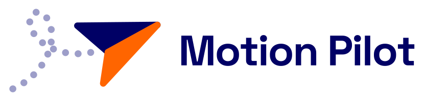

<p align="center">
  <picture>
    <source media="(prefers-color-scheme: dark)" srcset="assets/logo/logo-dark.svg">
    
  </picture>
</p>

[](https://github.com/Tee-David/Motion-Pilot/actions/workflows/check.yml)
[](https://skills.sh/Tee-David/Motion-Pilot)
[](LICENSE)
[](skills/motion-pilot/SKILL.md)

An Agent Skill that turns your coding agent into a motion director. It makes brand films, product demos, explainers, launch and social ads, logo reveals, kinetic type, website hero loops, preloaders and page transitions, and it reviews motion made by anyone.

It works with you rather than guessing. It asks for what would make the piece yours (your brand, your assets, a reference you love, how you picture it flowing), offers every ask as an option, and fills the gaps itself. Then it pitches three storylines, writes the film as numbers instead of adjectives, boards it, builds it, scores it, renders it, and checks it with measurements before you see it.

```bash
npx skills add Tee-David/Motion-Pilot
```

Works with Claude Code, Codex, Cursor, OpenCode and the other agents the [skills CLI](https://skills.sh) supports.

## What it makes

| Piece | What you get |
| --- | --- |
| Brand film, launch or social ad, reel | MP4 in 16:9 and 9:16, light and dark, with a synthesised score or your track, and a voice if you want one |
| Product demo, explainer | Real screens, a cursor that does the work, one idea a viewer can repeat |
| Logo reveal, end card | Your mark built from its own parts (drawn, constructed, gathered, morphed) and landing on your exact lockup |
| Website hero loop | A muted, seamless loop with posters, chapter times and the code to embed it |
| Preloader, page transition, UI motion | CSS choreography that never blocks the page and respects reduced motion |
| Review | Contact sheets, strips around every cut, a phone-width sheet, holds, dead stretches, off-palette blends and loudness, then ranked notes |

## How it works

1. **The brief.** It researches your site and assets, then asks at most five plain questions in one message. Every ask says what it improves; "just go" is always an answer.
2. **Three storylines.** Three different films in words, each with its first two seconds written out. You pick one.
3. **The spec.** Your film as numbers: colours and where the accent may appear, type sizes, easing curves by role, every shot with its one hero move and its hand-off.
4. **The storyboard.** One still per shot from the real build. You approve before anything is timed.
5. **Build, sound, voice.** A deterministic HTML engine where every frame is a pure function of time, so renders are reproducible and resumable.
6. **Review.** Measured with `review.py`, judged against a defect table, fixed until nothing breaks the read.
7. **Delivery.** The files, what was measured and what was only looked at, and every claim for you to confirm.

## Give it more, get more (all optional)

- **Your brand:** logo as SVG, colours and fonts, or just your website address.
- **Your material:** real screens, photos, past work, product clips.
- **A reference you love:** a link or a screen recording. Not sure where to look? Dribbble, Behance, Pinterest, Vimeo, Awwwards, Godly, Mobbin, or your own saved posts.
- **How you picture it:** "starts with the problem, ends on the logo", a rough list of scenes, a sketch.
- **A voice:** none, your own recording, ElevenLabs (with an API key or a file), any text-to-speech you already use, or a free local model.
- **Music:** a synthesised score, your licensed track, or silence.

## Requirements

Nothing is needed to plan, pitch, spec or board. To render:

- Python 3.10+ with `pip install -r requirements.txt`, then `python -m playwright install chromium`
- `ffmpeg` on your PATH
- Optional: `faster-whisper` for voice alignment, `kokoro-onnx` for a free local voice, `ELEVENLABS_API_KEY` for ElevenLabs

## Try it

Ask your agent:

> Make a 15 second launch reel for my app, tall and wide. Here is the site: example.com. I like how this one moves: <link>.

> Turn my logo into a preloader for my website. The SVG is attached.

> Review this animation and tell me why it feels cheap.


## What is inside

```
skills/motion-pilot/
  SKILL.md                    the steering document your agent reads first
  references/process/         the brief, storylines, spec, storyboard, review, delivery
  references/craft/           principles, timing and easing, transitions, type, logo construction,
                              composition, sound, voice, copywriting
  references/genres/          one playbook per kind of piece
  references/taste/           a 33-reference style library and the lessons behind the rules
  references/brands/          a brand profile template and a worked profile
  references/tech/            the engine API and the render pipeline
  engine/  templates/  scripts/  fonts/
  reference-implementations/  a voice-led reel and two shipped preloaders, as worked examples
```

## Documentation

- [Getting started](docs/getting-started.md)
- [How Motion Pilot works](docs/how-it-works.md)
- [Roadmap](ROADMAP.md)
- [Contributing](CONTRIBUTING.md)
- [Changelog](CHANGELOG.md)

## Contributing

Contributions are welcome, especially new genre playbooks, references with written analysis, and engine components. Open an issue before large changes. See [CONTRIBUTING.md](CONTRIBUTING.md).

## Author

**Taiwo David Dayomola**, Senior Software Engineer, created and maintains Motion Pilot to give every team the eye of a motion director: work that is planned, measured and made with the person who asked for it, never guessed.

## License

Apache License 2.0. See [LICENSE](LICENSE) and [NOTICE](NOTICE). The bundled Space Grotesk and Outfit fonts are under the SIL Open Font License 1.1.
